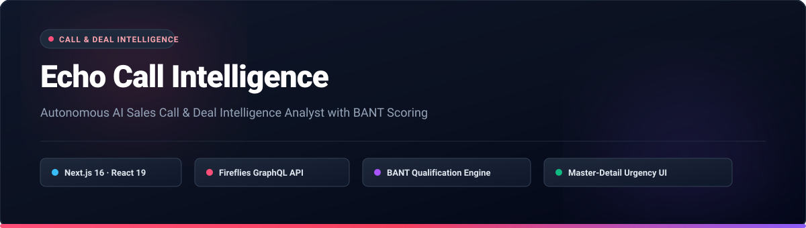
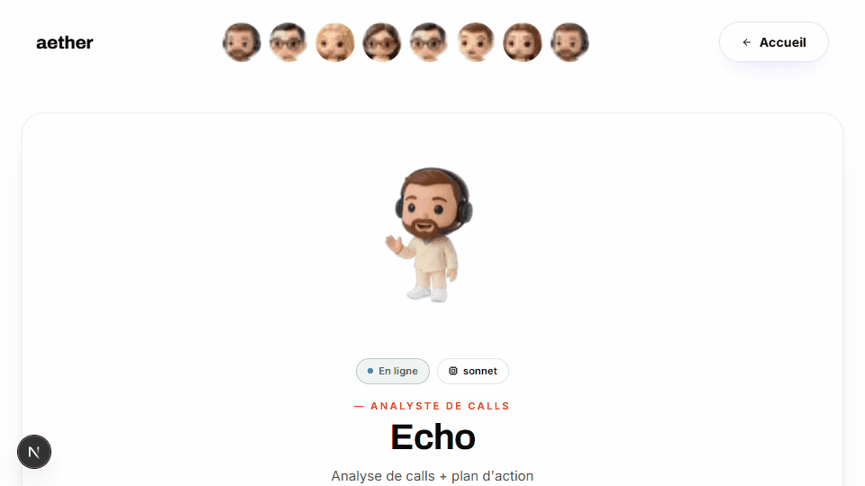
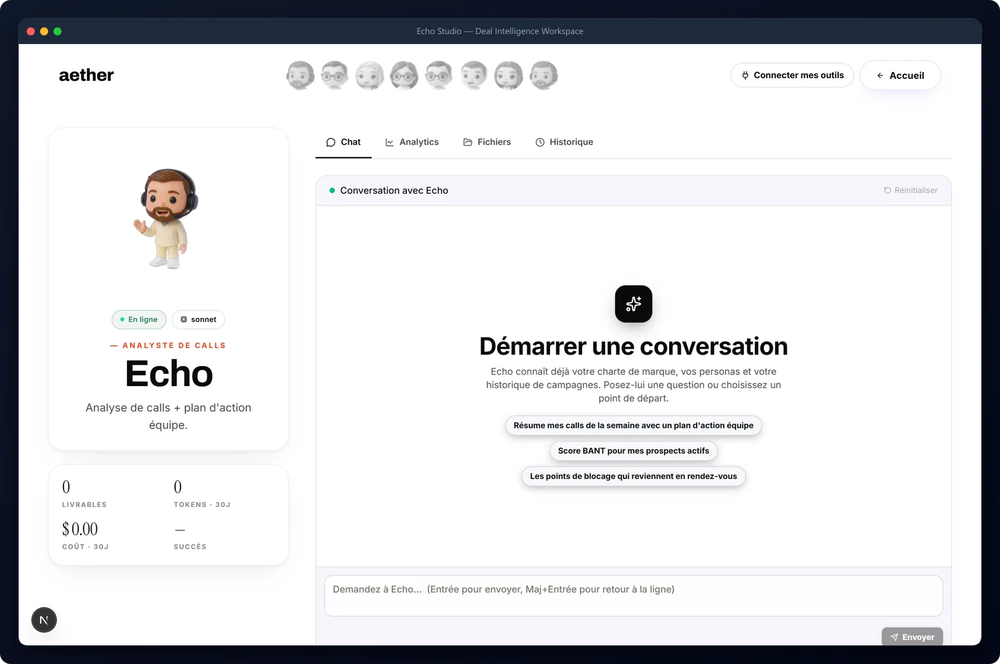
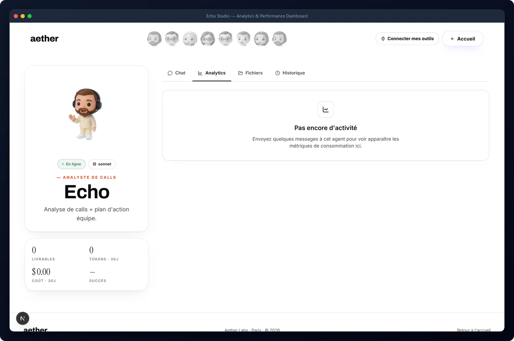
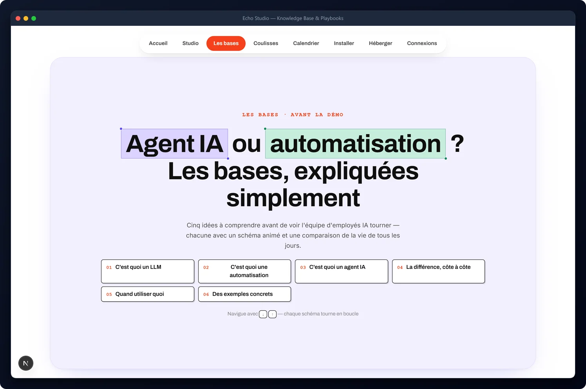
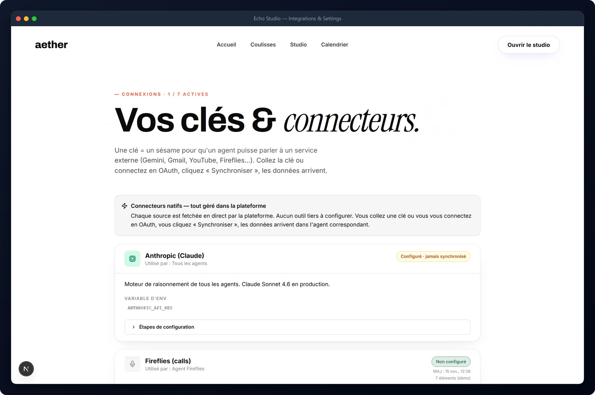
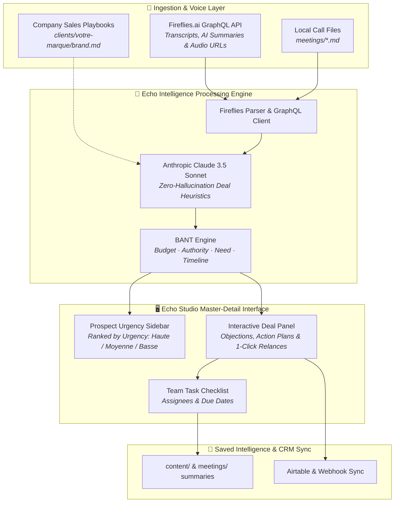

<div align="center">



[](https://nextjs.org/)
[](https://react.dev/)
[](https://www.typescriptlang.org/)
[](https://www.anthropic.com/)
[](https://fireflies.ai/)
[](https://github.com)
[](#-license)

**Autonomous AI Sales Call & Deal Intelligence Analyst powered by Next.js 16, Anthropic Claude, and Fireflies.ai GraphQL API**

*(Analyste d'Intelligence Commerciale & Synthèse de Calls : qualification BANT, plans d'action équipe, détection d'urgence et relances prêtes à l'envoi).*

[Live Demo](#-live-demo) · [Screenshots](#-screenshots) · [Architecture](#-architecture) · [Features](#-overview) · [Quick Start](#-how-to-install--configure) · [Customize](#-how-to-create--customize-agents)

</div>

---

## 🌟 Overview

**Echo** transforms raw sales calls, audio recordings, and customer meetings into actionable deal intelligence:
- **Direct Fireflies.ai Integration**: Direct GraphQL query integration (`https://api.fireflies.ai/graphql`) to fetch transcripts, AI overviews, speaker turns, and bullet-point summaries (with built-in offline demo data when no API key is provided).
- **BANT Qualification Engine**: Automatically evaluates deal viability across Budget, Authority, Need, and Timeline, estimating closing probabilities with grounded figures.
- **Master-Detail Prospect Dashboard UI**: Custom studio interface parsing structured `## [prospect]` blocks into an interactive workbench — a sidebar ranking prospects by urgency (`haute`, `moyenne`, `basse`), paired with a detailed panel for call recaps, task assignments, and one-click copyable follow-ups.
- **Team Action Plans**: Extracts prioritized to-do items formatted with assignees and explicit deadlines (`- [ ] Action | assignee | deadline: YYYY-MM-DD`).
- **Zero Hallucination Policy**: Adheres strictly to factual data explicitly mentioned in transcripts (conservative figures, verified buyer roles, and explicit next steps).

---

## ⚡ Live Demo



---

## 📸 Screenshots

<table width="100%">
  <tr>
    <td width="50%" align="center">
      <h4>1. Echo Deal Intelligence Workspace</h4>
      
      <p><em>Dedicated Echo workspace featuring live sales call review, prompt starters, real-time streaming analysis, and token tracking.</em></p>
    </td>
    <td width="50%" align="center">
      <h4>2. Analytics &amp; Performance Dashboard</h4>
      
      <p><em>Detailed usage metrics tracking tokens, API costs, call processing velocity, and analysis success rates.</em></p>
    </td>
  </tr>
  <tr>
    <td width="50%" align="center">
      <h4>3. Knowledge Base &amp; Company Playbooks</h4>
      
      <p><em>Contextual knowledge repository ingesting company offerings, pricing tiers, and objection-handling playbooks.</em></p>
    </td>
    <td width="50%" align="center">
      <h4>4. Integrations &amp; Tool Settings</h4>
      
      <p><em>Management panel for Fireflies.ai API keys, CRM sync, Google Workspace OAuth, and model overrides.</em></p>
    </td>
  </tr>
</table>

---

## 🏛️ Architecture



### Directory Layout

```
echo-call-intelligence/
├── .claude/
│   └── agents/
│       └── fireflies.md             # Echo agent blueprint, Master-Detail syntax & Claude prompt
├── aether-studio/                   # Full-stack Next.js 16 Studio application
│   ├── src/
│   │   ├── app/                     # Next.js app router, dashboard views & API routes
│   │   ├── components/              # Interactive components (Prospect Dashboard, Chat, Audio)
│   │   ├── data/                    # Mock meetings and fallback call transcripts
│   │   └── lib/                     # Fireflies connector, dashboard parser, and AI SDK
│   ├── .env.example                 # Documented template environment variables
│   ├── .gitignore                   # Studio gitignore with .env.example tracking exception
│   └── package.json                 # Studio dependencies & scripts
├── clients/
│   └── votre-marque/
│       └── brand.md                 # Your company context, value proposition, and sales playbooks
├── content/                         # Saved deal reviews and executive meeting briefings
├── docs/                            # Real product screenshots and visual assets
│   └── screenshots/
├── meetings/                        # Call transcripts, meeting notes & Fireflies synced data
├── propositions/                    # Commercial quotes and pitch decks
├── CLAUDE.md                        # Assistant onboarding instructions for Claude Code
├── .gitignore                       # Root repository ignore rules
└── README.md                        # Project documentation
```

### Key Architectural Concepts
- **Template Lock (`OWNED_AGENT=fireflies`)**: Locks the workspace interface directly to Echo's deal intelligence and sales meeting analysis dashboard.
- **Context Injection**: Echo automatically consumes live transcripts and meeting data through `{{MEETINGS_SNAPSHOT}}` alongside your company guidelines in `clients/votre-marque/brand.md`.
- **Zero Hallucination Policy**: Adheres strictly to factual data explicitly mentioned in transcripts (conservative figures, verified buyer roles, and explicit next steps).

---

## 🛠️ How to Install & Configure

### 1. Prerequisites
- **Node.js**: v20.x or later (LTS recommended)
- **Anthropic API Key**: [Anthropic Console](https://console.anthropic.com/settings/keys)
- **Fireflies.ai API Key** *(Optional)*: [Fireflies Integrations](https://app.fireflies.ai/integrations/api) (built-in offline mock data is active if omitted)

### 2. Installation
Navigate to the web application directory and install dependencies:

```bash
cd aether-studio
npm install
```

### 3. Environment Configuration
Copy `.env.example` to `.env.local`:

```bash
cp .env.example .env.local
```

Configure your environment variables in `.env.local`:

```env
# ================= MANDATORY CONFIGURATION =================
# Your Anthropic Claude API Key for deal reasoning & streaming
ANTHROPIC_API_KEY="sk-ant-api03-..."

# ================= AGENT TEMPLATE LOCK =================
# Locks Aether Studio interface directly to Echo (fireflies call intelligence)
OWNED_AGENT=fireflies
NEXT_PUBLIC_OWNED_AGENT=fireflies

# ================= OPTIONAL INTEGRATIONS =================
# Fireflies.ai API Key for automated meeting transcript sync (uses demo calls when unset)
FIREFLIES_API_KEY=

# Enriched prospect web scraping (Pulse / Hunter)
APIFY_TOKEN=

# Google OAuth Credentials for Gmail follow-up drafts and Google Drive storage
GOOGLE_CLIENT_ID=
GOOGLE_CLIENT_SECRET=
GOOGLE_REDIRECT_URI=http://localhost:3000/api/integrations/google/callback

# Model Overrides (defaults to Claude 3.5 Sonnet)
ANTHROPIC_MODEL_SONNET=claude-sonnet-4-20250514
ANTHROPIC_MODEL_OPUS=claude-opus-4-20250514
```

---

## 🚀 How to Use

### 1. Start the Development Server
```bash
cd aether-studio
npm run dev
```

Open [http://localhost:3000](http://localhost:3000) in your browser. With `OWNED_AGENT=fireflies` configured, you are automatically directed into Echo's workspace.

### 2. Core Workflows
- **Weekly Call Synthesis**: Click *"Résume mes calls de la semaine avec un plan d'action équipe"* to analyze all recorded meetings, cluster objections, and produce actionable next steps.
- **BANT Lead Qualification**: Prompt Echo with *"Score BANT pour mes prospects actifs"* to parse transcripts for Budget constraints, Decision Authority, real Need, and purchase Timeline.
- **Friction Point Identification**: Ask *"Les points de blocage qui reviennent en rendez-vous"* to extract recurring competitor mentions, pricing pushbacks, and technical concerns.
- **Copyable Follow-Up Emails**: Echo generates tailored, empathetic follow-up emails directly referencing specific discussion points and agreed deadlines from each prospect call.

---

## 🧠 How to Create & Customize Agents

You can fine-tune Echo's intelligence heuristics or extend the system with new agent personas:

### 1. Customizing Echo's Sales Heuristics
Echo's system prompt and reasoning framework are defined in `.claude/agents/fireflies.md`. You can adjust:
- **Qualification Criteria**: Change the BANT scoring methodology to MEDDIC, SPICED, or CHAMP.
- **Urgency Classification**: Adjust the criteria for flagging deals as `haute`, `moyenne`, or `basse` urgency.
- **Action Item Format**: Modify the task assignment syntax or CRM webhook payload format.

### 2. Connecting Real Fireflies Workspaces
Add your Fireflies API key to `.env.local`:
```env
FIREFLIES_API_KEY="your-fireflies-api-key"
```
Echo will automatically query the Fireflies GraphQL API (`https://api.fireflies.ai/graphql`) to fetch live meeting transcripts, participant speaker labels, and call audio timestamps.

### 3. Adapting Company Sales Context
Edit `clients/votre-marque/brand.md` to feed Echo your actual product catalog, pricing tiers, target ICP personas, and typical competitor differentiators so deal reviews match your exact business reality.

---

## ⚙️ Environment Variables Reference

| Variable | Type | Description |
|---|---|---|
| `ANTHROPIC_API_KEY` | **Required** | Your Anthropic Claude API key from [Anthropic Console](https://console.anthropic.com) |
| `OWNED_AGENT` | **Required** | Set to `fireflies` to lock the Studio to Echo |
| `NEXT_PUBLIC_OWNED_AGENT` | **Required** | Client-side template lock (`fireflies`) |
| `FIREFLIES_API_KEY` | Optional | Fireflies.ai API key for live meeting transcript sync (demo mode used if unset) |
| `APIFY_TOKEN` | Optional | Apify token for enriched prospect and company data |
| `GEMINI_API_KEY` | Optional | Google Gemini API key for visual assets |
| `GOOGLE_CLIENT_ID` | Optional | Google OAuth Client ID for Gmail and Drive sync |
| `GOOGLE_CLIENT_SECRET` | Optional | Google OAuth Client Secret |
| `GOOGLE_REDIRECT_URI` | Optional | OAuth callback URL (`http://localhost:3000/api/integrations/google/callback`) |
| `NEXT_PUBLIC_UNLOCK_URL` | Optional | Custom link for agent suite upgrade/unlock |

---

## 📄 License

This repository is distributed under the [MIT License](LICENSE).
